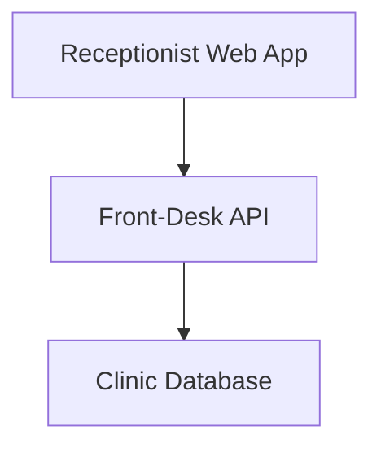
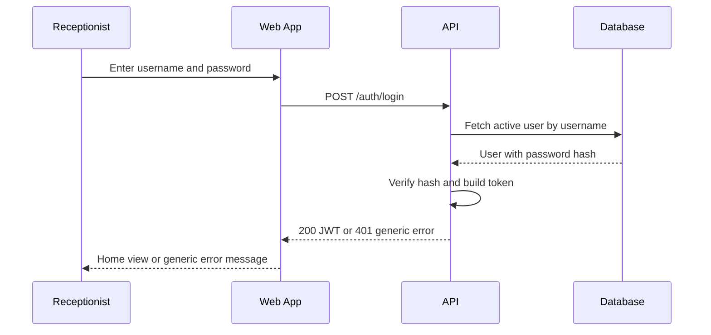
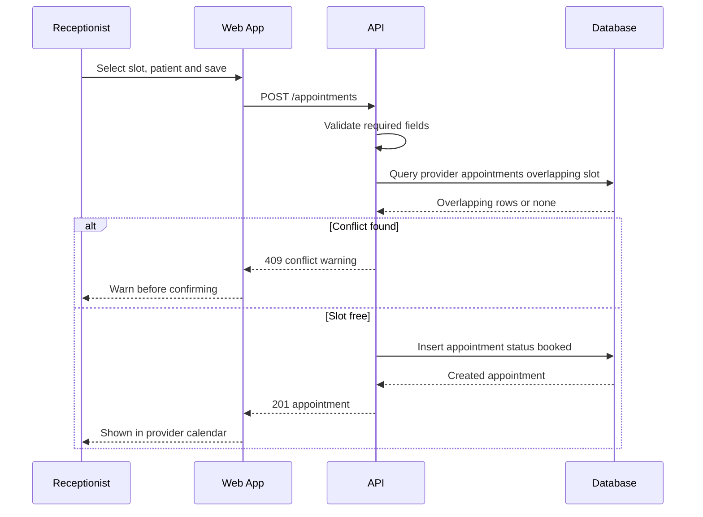
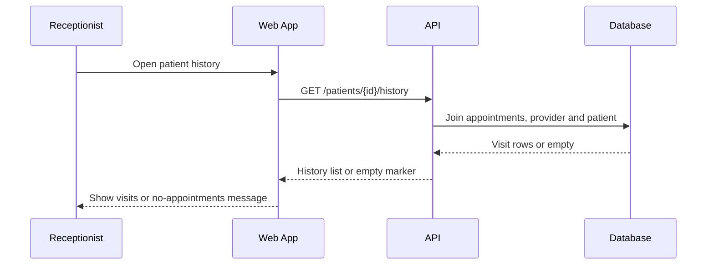
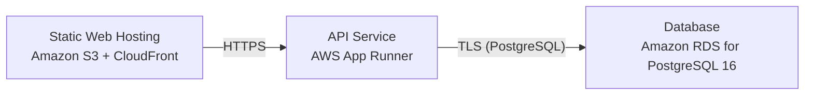

# Architecture

> Maintained by QuorQ AI SDLC. Text between `sdlc:auto` markers is regenerated; anything outside them is yours and is kept.

<!-- sdlc:auto:start narrative -->
## Overview

### ARCH-001 · approved · source: architecture:summary

DevonTester is architected as a lightweight, single-clinic front-desk tool: a React 19 SPA calling a FastAPI 0.115 JSON/HTTPS API backed by PostgreSQL 16, hosted on AWS.

Approved v1 architecture. Scope: receptionist sign-in (admin/staff roles), patient contact record management, per-provider day/week calendars, appointment booking/reschedule/cancel with conflict warnings, appointment status marking, per-patient visit history, and in-app help. The database enforces relational integrity and prevents double-booking. Per NFR-005, strict HIPAA controls (per-read audit logging, break-glass access, BAAs) are deliberately out of scope because only dummy/test data is used; HTTPS/TLS in transit, encryption at rest, and sign-in access control still apply. No real PHI, no clinical fields, and no EHR/FHIR/HL7 integration are designed into the system.

**Related:** NFR-005

- ⚠ Architecture input does not explicitly map this design to specific requirement IDs (US-001..US-018); traceability from stories to architecture decisions is not stated and should be confirmed.
- ⚠ NFR-005 scope decision (excluding strict HIPAA controls) should be cross-checked against actual requirements/compliance expectations if real patient data is ever introduced.

### ARCH-002 · approved · source: architecture:components

Three components make up the system: a React 19 receptionist web app, a FastAPI backend, and a PostgreSQL database.

Components: (1) web_frontend – Receptionist Web App (React 19): responsive desktop SPA covering sign-in, patient records, per-provider day/week calendar, booking/rescheduling/cancel, status marking, patient history, and in-app help; guards protected routes and redirects unauthenticated users. (2) api_backend – Front-Desk API (FastAPI 0.115): JSON API over HTTPS handling authentication/session tokens, role checks, patient CRUD and search, provider listing, appointment booking with overlap/conflict validation, status transitions, today's overview and patient history queries, and account management. (3) database – Clinic Database (PostgreSQL 16): relational store for users, patients, providers and appointments; enforces foreign keys and a double-booking exclusion constraint; serves calendar and history joins; encryption at rest enabled.

- ⚠ No explicit requirement IDs attached to individual components in the input; inferred only from functional descriptions.

### ARCH-003 · approved · source: architecture:critical_paths:signin

Defines the sign-in and protected-access flow for receptionists, including JWT issuance and route guarding.

Receptionist submits credentials; backend verifies the password hash and returns a JWT. The SPA stores the token, attaches it to API calls, and redirects unauthenticated navigation to sign-in. Failed sign-in returns a generic error that does not reveal which field was wrong, per NFR-002. Supported by endpoints POST /auth/login, POST /auth/logout, GET /auth/me.

**Related:** NFR-002

- ⚠ Token expiry/refresh behavior and blacklist-on-logout ('if enabled') are not fully specified — /auth/logout description notes blacklisting is conditional, condition not defined.

### ARCH-004 · approved · source: architecture:critical_paths:booking

Defines the appointment booking flow with double-booking conflict detection at both application and database layers.

Receptionist picks a provider slot, links a patient, and saves. The backend validates required fields, checks for an overlapping appointment for the same provider, and either warns of the conflict or persists the appointment with status 'booked'. A Postgres exclusion constraint (btree_gist on provider time ranges) is the final guard against double-booking. Satisfies AC-019 through AC-021. Supported by endpoints POST /appointments and PATCH /appointments/{id} (overlap check also applies on reschedule).

**Related:** AC-019, AC-020, AC-021

- ⚠ Exact UX of the 'conflict warning' (e.g., can the receptionist override it) is not detailed in architecture input.

### ARCH-005 · approved · source: architecture:critical_paths:history

Defines the per-patient visit history flow, joining appointment, provider, and patient contact data with no clinical fields.

Receptionist opens a patient's history; the backend joins appointments to provider and patient contact details and returns past and upcoming visits with date, provider, status, and reason-for-visit note. No clinical fields are present, satisfying AC-030 through AC-032 and NFR-004. Supported by endpoint GET /patients/{id}/history.

**Related:** AC-030, AC-031, AC-032, NFR-004

### ARCH-006 · approved · source: architecture:entities

Relational data model with four entities: users, patients, providers, and appointments.

users: id, username, password_hash, role, is_active, created_at. patients: id, first_name, last_name, phone, email, created_at, updated_at. providers: id, name, specialty, is_active. appointments: id, patient_id, provider_id, start_time, end_time, status, reason_note, created_by, created_at, updated_at. Appointments reference patients and providers via foreign keys; a database-level exclusion constraint on provider_id + time range prevents double-booking (see ARCH-004).

- ⚠ No explicit requirement IDs tied to individual entities/fields in the input.

### ARCH-007 · approved · source: architecture:endpoints

Full JSON API surface for authentication, account management, patients, providers, calendar, appointments, and help content.

Endpoints: POST /auth/login (authenticate, generic error on failure); POST /auth/logout (end session, optional token blacklist); GET /auth/me (current user/role for route guarding); GET /accounts, POST /accounts, PATCH /accounts/{id} (admin-only account listing/creation/edit-deactivate); GET /patients (search/list), POST /patients (create, validates required name), GET /patients/{id} (fetch), PATCH /patients/{id} (update, validates email format); GET /patients/{id}/history (visit history, no clinical data); GET /providers (list for calendar picker); GET /calendar (appointments for a provider, day/week range); GET /appointments/today (front-desk daily overview across providers); POST /appointments (book, validates fields, warns on overlap); PATCH /appointments/{id} (reschedule time/provider or edit reason note, overlap check applies); PATCH /appointments/{id}/status (set status to booked, attended, no-show, or cancelled); GET /help (in-app how-to documentation content).

**Related:** ARCH-003, ARCH-004, ARCH-005, ARCH-006

- ⚠ Pagination, rate limiting, and error-response schema for these endpoints are not specified in the architecture input.

### ARCH-008 · approved · source: architecture:deployment_nodes

AWS deployment topology: static SPA hosting, containerized API service, and managed relational database.

Deployment nodes: Static Web Hosting (Amazon S3 + CloudFront) serves the React 19 static build; API Service (AWS App Runner) runs FastAPI 0.115 on a Python container; Database (Amazon RDS for PostgreSQL 16) hosts the relational store. Chosen per NFR-001/NFR-006 for TLS in transit, encryption at rest, and tested backups in one AWS environment. HIPAA-eligible hosting and BAAs are noted as available later if real PHI is introduced, but are not part of current scope (see ARCH-001 / NFR-005).

**Related:** NFR-001, NFR-006

- ⚠ No deployment phase input yet exists to confirm this topology was actually provisioned — this entry documents the design/plan only.

### ARCH-009 · approved · source: architecture:technology_decisions

Documents the rationale for each major technology choice and the alternatives considered.

Frontend: React 19 chosen over Vue/Svelte because the front desk runs an interactive day/week calendar all day with booking, drag-to-reschedule, status flips, and a patient-history panel; React's component state model fits this stateful desktop-browser screen; delivered as a responsive SPA for desktop browsers (NFR-008). Backend: FastAPI 0.115 chosen over Express/Spring Boot because the logic is straightforward CRUD plus appointment validation and history reads; Pydantic request validation keeps patient and appointment payloads well-formed (AC-009, AC-011, AC-020) for a few concurrent staff. Database: PostgreSQL 16 chosen over MySQL/SQLite because patients, providers and appointments are relational; foreign keys enforce integrity and a btree_gist exclusion constraint on provider time ranges prevents double-booking (AC-021, AC-025); history is a simple join; encryption in transit and at rest supported. Cloud: AWS chosen over Azure/GCP for one reliable place to host the SPA, API and database with TLS in transit, encryption at rest and tested backups (NFR-001, NFR-006); HIPAA-eligible hosting and BAAs available later if real PHI is introduced.

**Related:** AC-009, AC-011, AC-020, AC-021, AC-025, NFR-001, NFR-006, NFR-008
<!-- sdlc:auto:end narrative -->

<!-- sdlc:auto:start building-blocks -->
## Building Block View

| ID | Name | Technology | Responsibility | Depends on |
|---|---|---|---|---|
| web_frontend | Receptionist Web App | React 19 | Responsive desktop SPA: sign-in, patient records, per-provider day/week calendar, booking/rescheduling/cancel, status marking, patient history, in-app help. Guards protected routes and redirects unauthenticated users. | api_backend |
| api_backend | Front-Desk API | FastAPI 0.115 | JSON API over HTTPS: authentication and session tokens, role checks, patient CRUD and search, provider listing, appointment booking with overlap/conflict validation, status transitions, today's overview and patient history queries, account management. | database |
| database | Clinic Database | PostgreSQL 16 | Relational store for users, patients, providers and appointments. Enforces foreign keys and a double-booking exclusion constraint; serves calendar and history joins. Encryption at rest enabled. | — |

<!-- sdlc:auto:end building-blocks -->

<!-- sdlc:auto:start runtime -->
## Runtime View

### Receptionist sign-in and protected access

Receptionist submits credentials; backend verifies the password hash and returns a JWT. The SPA stores the token, attaches it to API calls, and redirects unauthenticated navigation to sign-in. Failed sign-in returns a generic error that does not reveal which field was wrong (NFR-002).

- **Components:** web_frontend, api_backend, database
- **Modules:** auth.router, auth.security, auth.deps, users.repository
- **Key functions:** login(username, password), verify_password(plain, hash), create_access_token(user_id, role), get_current_user(token), require_role(role)

### Book appointment with conflict check

Receptionist picks a provider slot, links a patient and saves. The backend validates required fields, checks for an overlapping appointment for the same provider, and either warns of the conflict or persists the appointment with status 'booked'. A Postgres exclusion constraint is the final guard against double-booking (AC-019..AC-021).

- **Components:** web_frontend, api_backend, database
- **Modules:** appointments.router, appointments.service, appointments.repository
- **Key functions:** create_appointment(patient_id, provider_id, start, end, reason_note), find_overlaps(provider_id, start, end), validate_booking(payload)

### Per-patient visit history

Receptionist opens a patient's history; the backend joins appointments to provider and patient contact details and returns past and upcoming visits with date, provider, status and reason-for-visit note. No clinical fields are present (AC-030..AC-032, NFR-004).

- **Components:** web_frontend, api_backend, database
- **Modules:** patients.router, history.service, appointments.repository
- **Key functions:** get_patient_history(patient_id), list_appointments_for_patient(patient_id)

<!-- sdlc:auto:end runtime -->

<!-- sdlc:auto:start deployment-view -->
## Deployment View

| Name | Service | Runtime | Scaling | Environment |
|---|---|---|---|---|
| Static Web Hosting | Amazon S3 + CloudFront | React 19 static build | CDN edge cache, single clinic load | dev |
| API Service | AWS App Runner | FastAPI 0.115 on Python container | 1-2 instances, small concurrency | dev |
| Database | Amazon RDS for PostgreSQL 16 | PostgreSQL 16 | single instance, encryption at rest, automated backups | dev |

| Source | Target | Protocol |
|---|---|---|
| Static Web Hosting | API Service | HTTPS |
| API Service | Database | TLS (PostgreSQL) |

<!-- sdlc:auto:end deployment-view -->

<!-- sdlc:auto:start decisions -->
## Architecture Decisions

| Layer | Choice | ADR |
|---|---|---|
| Frontend | React 19 | [ADR-0001](adr/frontend.md) |
| Backend | FastAPI 0.115 | [ADR-0002](adr/backend.md) |
| Database | PostgreSQL 16 | [ADR-0003](adr/database.md) |
| Cloud | AWS | [ADR-0004](adr/cloud.md) |
<!-- sdlc:auto:end decisions -->

<!-- sdlc:auto:start links -->
## Related Documents

- [Data Model](data-model.md)
- [API Specification](api/openapi.yaml)
- [Architecture Decision Records](adr/README.md)
<!-- sdlc:auto:end links -->
