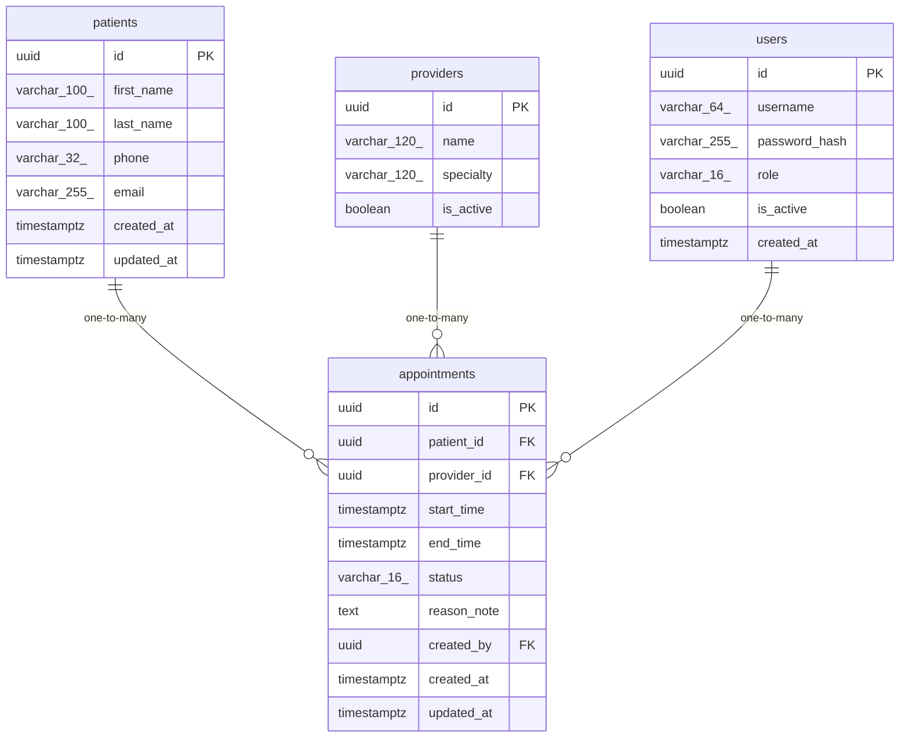

# Data Model

<!-- sdlc:auto:start entities -->
### users

| Field | Type | PK | FK | Nullable |
|---|---|---|---|---|
| id | uuid | True | — | False |
| username | varchar(64) | False | — | False |
| password_hash | varchar(255) | False | — | False |
| role | varchar(16) | False | — | False |
| is_active | boolean | False | — | False |
| created_at | timestamptz | False | — | False |

### patients

| Field | Type | PK | FK | Nullable |
|---|---|---|---|---|
| id | uuid | True | — | False |
| first_name | varchar(100) | False | — | False |
| last_name | varchar(100) | False | — | False |
| phone | varchar(32) | False | — | True |
| email | varchar(255) | False | — | True |
| created_at | timestamptz | False | — | False |
| updated_at | timestamptz | False | — | False |

### providers

| Field | Type | PK | FK | Nullable |
|---|---|---|---|---|
| id | uuid | True | — | False |
| name | varchar(120) | False | — | False |
| specialty | varchar(120) | False | — | True |
| is_active | boolean | False | — | False |

### appointments

| Field | Type | PK | FK | Nullable |
|---|---|---|---|---|
| id | uuid | True | — | False |
| patient_id | uuid | False | patients.id | False |
| provider_id | uuid | False | providers.id | False |
| start_time | timestamptz | False | — | False |
| end_time | timestamptz | False | — | False |
| status | varchar(16) | False | — | False |
| reason_note | text | False | — | True |
| created_by | uuid | False | users.id | True |
| created_at | timestamptz | False | — | False |
| updated_at | timestamptz | False | — | False |
<!-- sdlc:auto:end entities -->

<!-- sdlc:auto:start relationships -->
| Source | Target | Type |
|---|---|---|
| patients | appointments | one-to-many |
| providers | appointments | one-to-many |
| users | appointments | one-to-many |
<!-- sdlc:auto:end relationships -->

<!-- sdlc:auto:start er-diagram -->

<!-- sdlc:auto:end er-diagram -->
