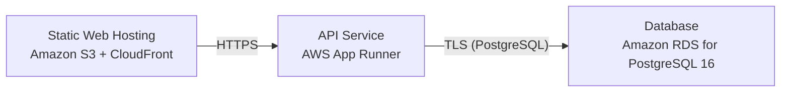

# Deployment Guide

> Maintained by QuorQ AI SDLC. Text between `sdlc:auto` markers is regenerated; anything outside them is yours and is kept.

<!-- sdlc:auto:start how-it-deploys -->
Pushes to `main` run `.github/workflows/deploy.yml`, which builds the API image (if there is a backend) and deploys the SPA to AWS Amplify. Commits touching only `docs/sdlc/**` don't deploy. Deployments can also be started from the platform's Deployment tab.
<!-- sdlc:auto:end how-it-deploys -->

<!-- sdlc:auto:start environments -->
| Name | Service | Runtime | Scaling | Environment |
|---|---|---|---|---|
| Static Web Hosting | Amazon S3 + CloudFront | React 19 static build | CDN edge cache, single clinic load | dev |
| API Service | AWS App Runner | FastAPI 0.115 on Python container | 1-2 instances, small concurrency | dev |
| Database | Amazon RDS for PostgreSQL 16 | PostgreSQL 16 | single instance, encryption at rest, automated backups | dev |
<!-- sdlc:auto:end environments -->

<!-- sdlc:auto:start live -->
**Frontend URL:** https://pc45059a34347.d3j61xaup4zgrx.amplifyapp.com

**Backend URL:** https://44-236-49-81.sslip.io/apps/c45059a34347/

**Database:** PostgreSQL · app

**Version:** 3d96db9bc59a

**Commit:** `3d96db9`

**Finished:** 2026-10-28
<!-- sdlc:auto:end live -->

<!-- sdlc:auto:start topology -->

<!-- sdlc:auto:end topology -->
